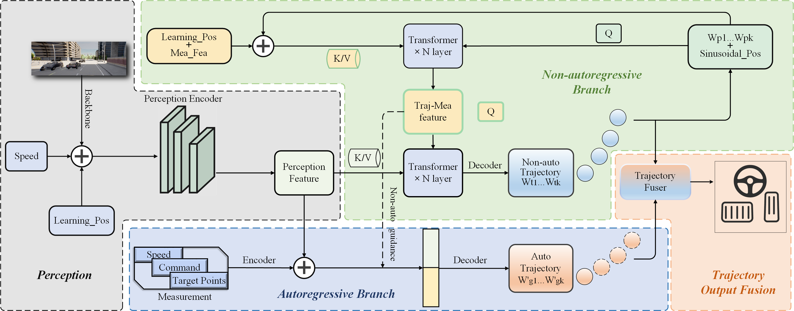

<p align="center">
  <h2 align="center">HyTraj: A Closed-Loop End-to-End Autonomous Driving Framework Unifying Autoregressive and Non-Autoregressive Planning</h2>
  <p align="center">
    Tao Xu, Guang Chen, Lulu Zhou, Zufeng Zhang, Weike Lu<br>
    IROS 2026 &nbsp;|&nbsp; <a href="https://leaderboard.carla.org/">CARLA Leaderboard</a>
  </p>
</p>

<p align="center">
  
</p>

This repository contains the code of the HyTraj framework.

## Setup

HyTraj is evaluated in CARLA 0.9.10.1 with [Leaderboard v1](https://github.com/carla-simulator/leaderboard), following [TCP](https://github.com/OpenPerceptionX/TCP).

```bash
mkdir carla
cd carla
wget https://carla-releases.s3.eu-west-3.amazonaws.com/Linux/CARLA_0.9.10.1.tar.gz
wget https://carla-releases.s3.eu-west-3.amazonaws.com/Linux/AdditionalMaps_0.9.10.1.tar.gz
tar -xf CARLA_0.9.10.1.tar.gz
tar -xf AdditionalMaps_0.9.10.1.tar.gz
cd ..
```

If the S3 links fail, use the [CARLA 0.9.10.1 release](https://github.com/carla-simulator/carla/releases/tag/0.9.10.1).

```bash
git clone https://github.com/sii-pilab/HyTraj.git
cd HyTraj
conda env create -f environment.yml
conda activate hytraj
export PYTHONPATH=$PYTHONPATH:$(pwd)
```

`environment.yml` uses Python 3.7, PyTorch 1.10 and CUDA 11.3. For another CUDA build see [pytorch.org](https://pytorch.org); keep `pytorch-lightning==1.2.5`.

## Dataset

Training uses 189K frames collected by the [Roach](https://github.com/zhejz/carla-roach) expert in Towns 1, 3, 4 and 6 at 10 Hz.

Download the TCP dataset from [Huggingface](https://huggingface.co/datasets/craigwu/tcp_carla_data), [Google Drive](https://drive.google.com/file/d/1HZxlSZ_wUVWkNTWMXXcSQxtYdT7GogSm/view) or [BaiduYun](https://pan.baidu.com/s/11xBZwAWQ3WxQXecuuPoexQ) (code `8174`):

```bash
cat tcp_carla_data_part_* > tcp_carla_data.zip
unzip tcp_carla_data.zip
export HYTRAJ_DATA_ROOT=/path/to/tcp_carla_data
```

To collect data yourself, start CARLA and edit `leaderboard/scripts/data_collection.sh`:

```bash
cd CARLA_ROOT
./CarlaUE4.sh --world-port=2000 -opengl
```

```bash
sh leaderboard/scripts/data_collection.sh
python tools/filter_data.py --result_path PATH_TO_JSON --data_path PATH_TO_RAW
python tools/gen_data.py --data_path PATH_TO_RAW
export HYTRAJ_DATA_ROOT=PATH_TO_RAW
```

Value heads are initialized from `roach/log/ckpt_11833344.pth`.

## Training

We train on 4 GPUs with batch size 32 for 80 epochs, learning rate `1e-4`:

```bash
python hytraj/train.py --gpus 4 --batch_size 32 --epochs 80 --lr 1e-4 --id hytraj
```

To freeze a pretrained encoder:

```bash
python hytraj/train.py --gpus 4 --batch_size 32 --epochs 80 --id hytraj_enc
python hytraj/train.py --gpus 4 --batch_size 32 --epochs 80 --id hytraj --encoder_ckpt log/hytraj_enc/encoder.pth
```

Logs and checkpoints are saved under `log/<id>/`.

## Evaluation

Launch CARLA, set `CARLA_ROOT` and `TEAM_CONFIG` in the script, then run:

```bash
cd CARLA_ROOT
./CarlaUE4.sh --world-port=2000 -opengl
```

```bash
sh leaderboard/scripts/run_evaluation.sh       # Town05 Short
sh leaderboard/scripts/run_evaluation_long.sh  # Town05 Long
```

Routes:

- `leaderboard/data/validation_routes/routes_town05_short.xml`
- `leaderboard/data/evaluation_routes/routes_town05_long.xml`
- `leaderboard/data/scenarios/all_towns_traffic_scenarios.json`

## Acknowledgements

- [TCP](https://github.com/OpenPerceptionX/TCP)
- [TransFuser](https://github.com/autonomousvision/transfuser)
- [Roach](https://github.com/zhejz/carla-roach)
- [CARLA Leaderboard](https://github.com/carla-simulator/leaderboard)
- [Scenario Runner](https://github.com/carla-simulator/scenario_runner)

## Citation

```bibtex
@inproceedings{xu2026hytraj,
  title     = {HyTraj: A Closed-Loop End-to-End Autonomous Driving Framework Unifying Autoregressive and Non-Autoregressive Planning},
  author    = {Xu, Tao and Chen, Guang and Zhou, Lulu and Zhang, Zufeng and Lu, Weike},
  booktitle = {IEEE/RSJ International Conference on Intelligent Robots and Systems (IROS)},
  year      = {2026}
}
```

## License

All code within this repository is under [Apache License 2.0](LICENSE).
